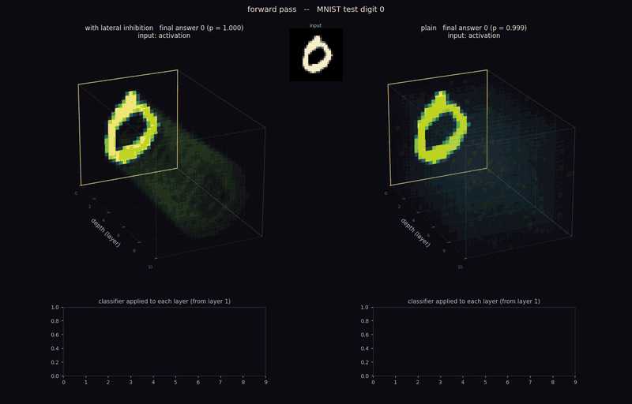

# Conway-Net

Clean reference implementation of **cellular-automaton lateral inhibition** for image classification,
and the code behind every figure, table and number in the paper.

**Project page and interactive demo:** [lateralintuition.com](https://lateralintuition.com) — draw a digit and
follow it through a 10-layer MLP with and without lateral inhibition, in the browser.

A layer is a non-local linear op (`conv`/`linear`) followed by the bounded nonlinearity `tanh`.
Let `x` be the input to that op and `z` its `tanh` output. The lateral-inhibition gate rewires the
layer as

```
z = LI(x, z)
```

(the birth/survive gates are computed from the layer **input** `x`). The gate runs a
continuous Game-of-Life-style rule (paper: `B5/S3`) over each cell's neighbourhood and
blends the birth/survive fields with the activation. Setting the mechanism to `none` gives the
plain `tanh` network — the two are the only arms this repo supports.

<p align="center">
  <a href="media/ConwayNet_activation_and_sailency.mp4">
    
  </a>
</p>
<p align="center"><em>The 10-layer MNIST MLP with lateral inhibition (left) and plain (right), on test digits 0–9:
the activations of every hidden layer in the forward pass, then the sensitivity of the predicted class to each
activation, |∂logit/∂activation|, in the backward pass. Click for the full video
(<a href="media/ConwayNet_activation_and_sailency.mp4">mp4</a>).</em></p>

## Scope

The code holds only what the paper uses.

- **Mechanism:** the CA gate (`ca`), or `none`. Rule, neighbourhood radius (0, 1, 2), channel reduction
  `mean` (at the `input` or `gates` stage) and the per-channel background-referenced image gate
  (`input_site:perch_bgref`, the CNN).
- **Networks:** `FullyConnectedNet` (Linear → LayerNorm → tanh → gate), `BaselineCNN` (two conv stages; the first
  gate reads the image), `WideResNet` (WRN-40-2; a stem convolution precedes every gate), `GraphGCN` (2-layer graph
  convolutional network on the 8-neighbour pixel graph).
- **Datasets:** MNIST, FashionMNIST, KMNIST, EMNIST (balanced), their blue/gold `*_COLOR` variants, CIFAR-10.
- **Training:** SGD / Adam / Muon, constant or cosine LR, AugMix (WRN), geometric affine augmentation and the
  matched-accuracy protocol (2-layer FCN).
- **Activation:** `tanh` only (the CA gate operates on bounded state).

Removed options are listed in `conwaynet/config.py` (`_RETIRED`): an old config that carries one loads only
when it holds the option's off value.

## Layout

```
conwaynet/
  lateral_inhibition.py   # the CA gate
  models.py               # FullyConnectedNet, BaselineCNN, WideResNet, build_model
  data.py                 # dataset loaders + 3-way split (stratified val carved from train; test held out)
  config.py               # single-run config: nested JSON flattened and validated
  optimizers.py           # Muon (+ AdamW for non-matrix parameters); SGD/Adam are torch built-ins
  train.py                # training loop + optimizer selection
  augment.py              # GPU AugMix and affine augmentation
  corruptions.py, robustness.py, eval.py   # noise ladders (9 severities) and the noise-accuracy curves
configs/                  # configs of every network in the paper
scripts/run.py            # train one config: python scripts/run.py configs/<cfg>.json
scripts/run_matched.py, scripts/fcn2_matched_targets.py, scripts/run_snapshots.py   # matched accuracy, snapshots
paper_figures/            # one script per paper figure (and the activation video); outputs in paper_figures/out/
                          # under the manuscript's file names; index in paper_figures/README.md
paper_code/               # the analyses behind the tables and the numbers in the text, and the caches the
                          # figure scripts read (training of the control networks included)
paper_checkpoints/        # the canonical trained networks + verify.py
paper_runs/               # every trained run (checkpoints, configs, results)
media/                    # the activation-and-saliency video shown above, and its preview
```

## Usage

```bash
pip install -e .
python scripts/run.py configs/paper/cnn_mnist_perch_ca.json
PYTHONPATH=. python paper_checkpoints/verify.py      # rebuild + re-test every canonical checkpoint
```

## License and patents

Copyright (c) 2025-2026 Yair Cohen. Licensed under the [PolyForm Noncommercial License 1.0.0](LICENSE): any
noncommercial use is permitted, including academic research and teaching; commercial use requires a separate
license from the author. The method is the subject of pending patent applications (U.S. Provisional
No. 63/860,671; PCT/IL2026/050267) owned by Yair Cohen; see [PATENTS](PATENTS) and [NOTICE](NOTICE).

